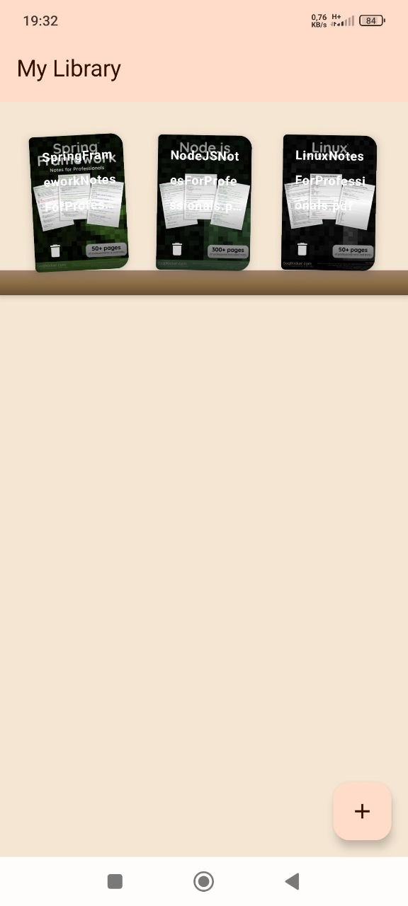
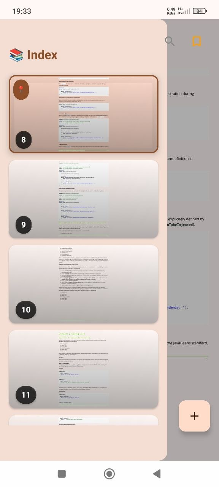
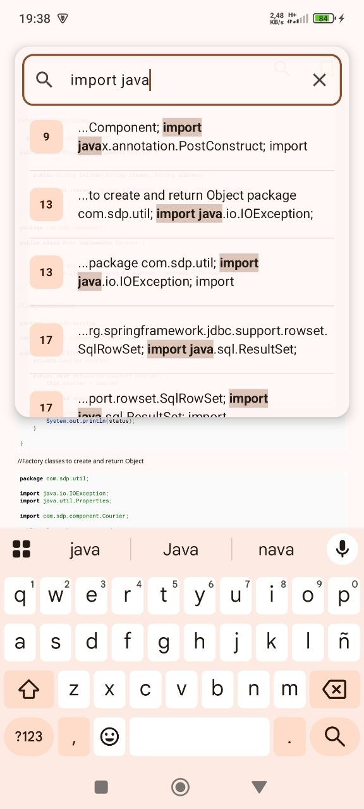
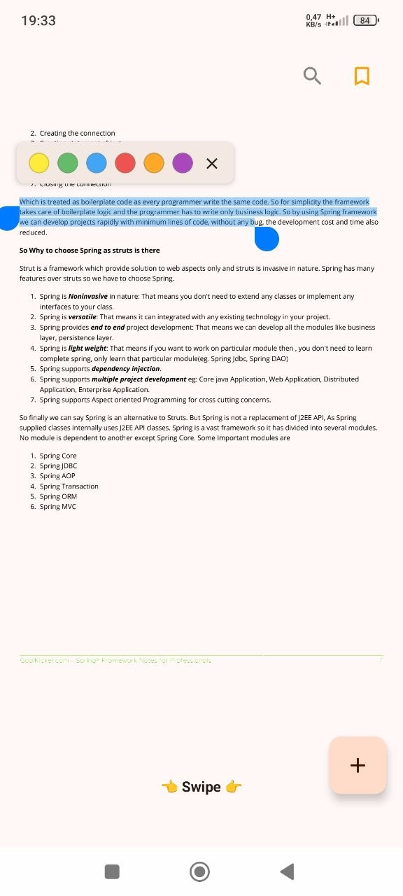

# PdfViewer

A modern, visually immersive, and feature-rich Android PDF Reader application built with Jetpack Compose. Instead of a standard file list, it features a warm, realistic **Bookshelf Interface** to display your PDF library and comes packed with tools to annotate, highlight, bookmark, and read documents seamlessly.

---

## Screenshots

<p align="center">
  
  
  
</p>
<p align="center">
  
  
  
</p>

---

##  Key Features

### 1. Interactive Bookshelf Library 
*   **Visual Shelf Layout**: Books are displayed as colorful covers placed on a wooden shelf row.
*   **Unique Customizations**: Covers have randomized colors and subtle tilt rotations to mimic a physical library.
*   **Storage Access**: Easily import PDFs from local storage.

### 2. Custom Interactive PDF Viewer 
*   **Smooth Gesture Controls**: Support for pinch-to-zoom, pan, and double-tap zoom for readability.
*   **Auto-Resume**: Remembers your exact position and resumes from the last read page for each document automatically.
*   **Edge-to-Edge Experience**: Utilizes modern Android inset handling for immersive reading.

### 3. Annotation & Study Tools 
*   **Bookmarks**: Bookmark critical pages and access them via a quick toggle.
*   **Sticky Page Notes**: Save, edit, and delete text notes attached to any specific page in the document.
*   **Text Highlighting**: Highlight text snippets in various colors (coordinates and text snippets are stored in the local database).

### 4. Visual Thumbnail Drawer 
*   **Thumbnail Previews**: Open a sliding drawer to view page thumbnails, enabling rapid visual navigation through the document.

---

## Technology Stack

The application leverages the latest modern Android development tools and best practices:

*   **UI Framework**: [Jetpack Compose](https://developer.android.com/compose) (100% Declarative UI)
*   **Modularization**: Reusable Android library module (`:pdfviewer-sdk`) published with `maven-publish`
*   **Dependency Injection**: [Dagger Hilt](https://developer.android.com/training/dependency-injection/hilt-android) (app module only; the SDK is DI-agnostic)
*   **Local Database**: [Room SQL Database](https://developer.android.com/training/data-storage/room) (Handles book metadata, bookmarks, highlights, and page notes)
*   **PDF Rendering Engine**: [PdfBox-Android](https://github.com/TomRoush/PdfBox-Android) (For robust PDF parsing, text selection, and rendering)
*   **Navigation**: [Jetpack Compose Navigation](https://developer.android.com/guide/navigation/navigation-principles)
*   **Language**: [Kotlin](https://kotlinlang.org/)
*   **Build System**: Gradle Kotlin DSL with Version Catalogs (`libs.versions.toml`)

---

##  Architecture

The project is split into two Gradle modules and follows **Clean Architecture** guidelines with the **MVI (Model-View-Intent)** presentation pattern:

| Module | Type | Responsibility |
| --- | --- | --- |
| `:app` | Android application | Bookshelf library, global annotations screen, Hilt DI, and the app database (`app_database`). |
| `:pdfviewer-sdk` | Android library | Everything that happens once a PDF is opened: rendering, gestures, zoom, text selection, highlights, bookmarks, page notes, search, thumbnails, TTS, and reading progress. |

The app depends on the SDK (`implementation(project(":pdfviewer-sdk"))`). The SDK has no dependency on the app and no dependency on Hilt, so it can be dropped into any Compose app.

### `:app` module

```
com.fmaestre98.pdfviewer
│
├── di/                   # Hilt modules (repositories + PdfViewerStorage binding)
├── models/               # Domain models (e.g., Book)
├── repository/           # Repository interfaces and implementations
├── room/                 # Room database, entities, and DAOs (app_database)
├── sdk/                  # AppPdfViewerStorage: bridges app_database to the SDK storage contract
│
└── ui/
    ├── navigation/       # Navigation routes
    ├── theme/            # Theme, color schemes, and typography
    └── screens/
        ├── home/         # Bookshelf screen (State, Action, Event, VM, Screen)
        └── annotations/  # Annotations across all books
```

### `:pdfviewer-sdk` module

```
com.fmaestre98.pdfviewer.sdk
│
├── ui/
│   ├── PdfReaderView.kt      # Public entry point (full reader screen)
│   ├── annotations/          # Optional per-document annotations screen
│   └── reader/               # Reader screen, ViewModel, and components (internal)
├── model/                    # Public PdfSource, PdfViewerConfig, PdfViewerColors
├── storage/                  # Public PdfViewerStorage contract + default Room implementation
├── data/                     # Internal Room database used by the default storage
└── core/                     # Internal engine: rendering, gestures, overlays, text extraction, search, TTS
```

Only the types needed by host apps are public. The rendering engine (`core`), the internal database (`data`), and the reader internals (`ui/reader`) are marked `internal`.

### Data Flow (MVI)
1.  **UI/Screens** emit **Actions** (e.g., `OnPageChanged`, `SavePageNote`) to the **ViewModel**.
2.  The **ViewModel** processes the action, interacts with **Repositories** or the **`PdfViewerStorage`** contract, and updates the **State**.
3.  The **UI** observes the **State** and recomposes reactively. One-time side effects (e.g., displaying Snackbars, navigation) are handled via an **Events** channel.

### Persistence
The reader never talks to a database directly. It goes through the `PdfViewerStorage` interface, which covers bookmarks, highlights, page notes, and the last read page:

*   In this app, `AppPdfViewerStorage` implements the interface on top of `app_database`. Everything saved in the reader is visible in the app's Annotations screen, and books reopen on the last read page.
*   Apps without their own database can use `RoomPdfViewerStorage`, a default implementation backed by an internal SDK database (`pdf_sdk_internal.db`).

---

##  Reusing the PDF Viewer in Other Apps

The `:pdfviewer-sdk` module provides the full reading experience of this app (all the features listed above, except the bookshelf library) as a single composable.

### Requirements
*   `minSdk` 24 or higher
*   Jetpack Compose enabled in the host app
*   A Material 3 theme around the composable (the SDK uses `MaterialTheme` colors and typography)

### 1. Add the dependency

**Option A: as a local module (same repository or a Git submodule)**

Copy or link the `pdfviewer-sdk` folder into your project, then:

```kotlin
// settings.gradle.kts
include(":pdfviewer-sdk")

// app/build.gradle.kts
dependencies {
    implementation(project(":pdfviewer-sdk"))
}
```

The SDK uses the version catalog aliases from `gradle/libs.versions.toml` (Compose BOM, Lifecycle, Room, KSP, PdfBox-Android). Make sure the host project declares the same aliases, plus the `android-library`, `kotlin-compose`, and `ksp` plugins.

**Option B: as a Maven artifact**

Publish the library from this repository:

```bash
./gradlew :pdfviewer-sdk:publishReleasePublicationToMavenLocal
```

Then consume it from any other project:

```kotlin
// settings.gradle.kts
dependencyResolutionManagement {
    repositories {
        google()
        mavenCentral()
        mavenLocal()
    }
}

// app/build.gradle.kts
dependencies {
    implementation("com.fmaestre98:pdfviewer-sdk:1.0.0")
}
```

To share it with a team, point the `publishing` block in [`pdfviewer-sdk/build.gradle.kts`](pdfviewer-sdk/build.gradle.kts) to a remote repository (for example GitHub Packages) instead of `mavenLocal()`.

### 2. Show the reader

The simplest integration uses the built-in storage, so no extra setup is needed:

```kotlin
import com.fmaestre98.pdfviewer.sdk.model.PdfSource
import com.fmaestre98.pdfviewer.sdk.ui.PdfReaderView

@Composable
fun ReaderScreen(pdfUri: Uri, onBack: () -> Unit) {
    PdfReaderView(
        source = PdfSource.FromUri(pdfUri),
        onClose = onBack
    )
}
```

PDFBox is initialized automatically by the SDK, so you do not need to call `PDFBoxResourceLoader.init` in your `Application` class.

### 3. Choose a PDF source

| Source | Usage |
| --- | --- |
| `PdfSource.FromUri(uri)` | `content://` or `file://` URIs (e.g., from the system file picker or a share intent). Content URIs are cached once in the app cache directory. |
| `PdfSource.FromFile(file)` | A `File` already stored on the device. |
| `PdfSource.FromAsset("docs/manual.pdf")` | A PDF bundled in the host app's `assets` folder. |

### 4. Configure the reader

```kotlin
import com.fmaestre98.pdfviewer.sdk.core.model.PdfViewerOrientation
import com.fmaestre98.pdfviewer.sdk.model.PdfViewerColors
import com.fmaestre98.pdfviewer.sdk.model.PdfViewerConfig

PdfReaderView(
    source = PdfSource.FromFile(file),
    documentId = "book-42",
    config = PdfViewerConfig(
        initialPage = null,                                 // null = resume from the last read page
        initialOrientation = PdfViewerOrientation.Vertical, // Horizontal by default
        enableAnnotations = true,                           // highlights and page notes
        enableBookmarks = true,
        enableSearch = true,
        enableThumbnailDrawer = true,
        colors = PdfViewerColors(
            selectionHighlight = Color(0x40FF9800),
            selectionHandle = Color(0xFFFF9800)
        )
    ),
    onClose = { navController.popBackStack() }
)
```

`documentId` is the key used to store annotations and reading progress. By default it comes from the source (the URI string, the file's absolute path, or `asset://<path>`). Pass your own stable ID if the file location can change, for example a database primary key.

### 5. Use your own database (optional)

To keep bookmarks, highlights, notes, and reading progress in your app's database, implement `PdfViewerStorage` and pass it to the reader:

```kotlin
class MyPdfViewerStorage(
    private val dao: MyAnnotationsDao
) : PdfViewerStorage {
    override suspend fun getBookmarkedPages(documentId: String): Set<Int> = TODO()
    override suspend fun isPageBookmarked(documentId: String, page: Int): Boolean = TODO()
    override suspend fun toggleBookmark(documentId: String, page: Int): Boolean = TODO()

    override suspend fun getHighlightsByPage(documentId: String): Map<Int, List<PdfHighlight>> = TODO()
    override suspend fun saveHighlight(
        documentId: String,
        page: Int,
        snippet: String,
        color: String,
        groupId: String,
        rects: List<NormalizedRect>
    ) = TODO()
    override suspend fun deleteHighlight(groupId: String) = TODO()

    override suspend fun getPageNote(documentId: String, page: Int): PdfPageNote? = TODO()
    override suspend fun savePageNote(documentId: String, page: Int, text: String, color: String?) = TODO()
    override suspend fun deletePageNote(documentId: String, page: Int) = TODO()

    override suspend fun getLastReadPage(documentId: String): Int? = TODO()
    override suspend fun saveLastReadPage(documentId: String, page: Int) = TODO()

    // Optional: live updates for annotation list screens
    override fun observeAnnotations(documentId: String): Flow<PdfDocumentAnnotations> = TODO()
}
```

```kotlin
PdfReaderView(
    source = PdfSource.FromUri(uri),
    documentId = bookId,
    storage = myPdfViewerStorage,
    onClose = onBack
)
```

Highlight rectangles are stored in normalized coordinates (`0..1` relative to the page size), so they render correctly at any zoom level or screen size. [`AppPdfViewerStorage`](app/src/main/java/com/fmaestre98/pdfviewer/sdk/AppPdfViewerStorage.kt) is a complete reference implementation built with Hilt and Room.

With Hilt, bind your implementation once and inject it where you show the reader:

```kotlin
@Binds
@Singleton
abstract fun bindPdfViewerStorage(impl: MyPdfViewerStorage): PdfViewerStorage
```

### 6. Per-document annotations screen (optional)

The SDK also includes a ready-made list of annotations for a single document:

```kotlin
val viewModel: AnnotationsViewModel = viewModel(
    factory = AnnotationsViewModel.Factory(documentId = bookId, storage = storage)
)
val state by viewModel.state.collectAsStateWithLifecycle()

AnnotationsScreen(
    state = state,
    onAction = viewModel::onAction
)
```

Collect `viewModel.events` to handle `NavigateToReader(documentId, page)` and `NavigateBack`. The list updates live when the storage overrides `observeAnnotations`.

### Public API summary

| Type | Package | Purpose |
| --- | --- | --- |
| `PdfReaderView` | `sdk.ui` | Full reader composable |
| `PdfSource` | `sdk.model` | Where the PDF comes from |
| `PdfViewerConfig`, `PdfViewerColors` | `sdk.model` | Feature flags, initial page/orientation, colors |
| `PdfViewerOrientation` | `sdk.core.model` | `Horizontal` (paged) or `Vertical` (continuous scroll) |
| `PdfViewerStorage` | `sdk.storage` | Persistence contract |
| `PdfHighlight`, `PdfPageNote`, `PdfBookmark`, `NormalizedRect`, `PdfDocumentAnnotations` | `sdk.storage` | Storage models |
| `RoomPdfViewerStorage`, `rememberDefaultPdfViewerStorage()` | `sdk.storage` | Default storage |
| `AnnotationsScreen`, `AnnotationsViewModel` | `sdk.ui.annotations` | Optional annotations list |
| `PdfRendererManager` | `sdk.core.rendering` | Page bitmap rendering, used for cover thumbnails in this app |

All packages are relative to `com.fmaestre98.pdfviewer`.

---

##  Getting Started

### Prerequisites
*   Android Studio Ladybug (or newer)
*   JDK 17+
*   Android SDK 35+

### Build and Run
1.  Clone the repository:
    ```bash
    git clone https://github.com/fmaestre98/pdfViewer.git
    cd pdfViewer
    ```
2.  Open the project in Android Studio.
3.  Sync the project with Gradle files.
4.  Run the application on an emulator or a physical device (Android 8.0+ / API 26+ recommended).

---

##  License

This project is licensed under the MIT License - see the [LICENSE](LICENSE) file for details.

Copyright (c) 2026 Fabian Ortiz
